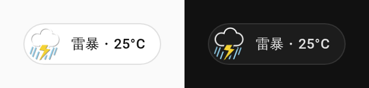
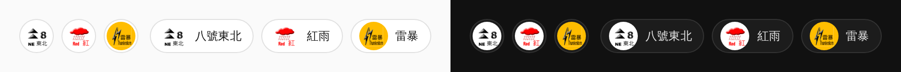
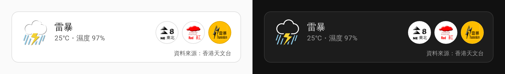
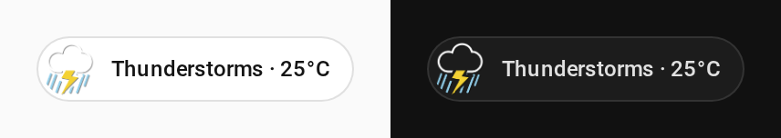
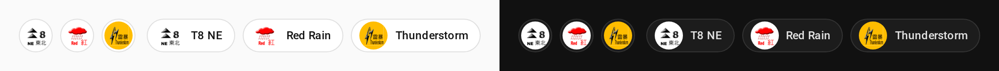
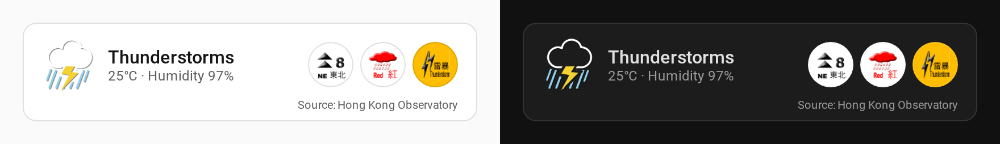

# hkweather

[中文](#中文) | [English](#english)

## 中文

在 Home Assistant dashboard 上顯示香港天文台的**現時天氣圖示**和**生效中的天氣警告**。

- **天氣 badge**（`custom:hkweather-weather-badge`）

  

- **警告 badge**（`custom:hkweather-warnings-badge`）

  

- **卡片**（`custom:hkweather-card`）

  

數據在瀏覽器內直接向天文台讀取，預設每 5 分鐘或載入頁面時更新；頁面隱藏時則暫停更新。

### 安裝

#### 方法一：HACS（建議）

[](https://my.home-assistant.io/redirect/hacs_repository/?owner=Huiyuen07&repository=hkweather&category=plugin)

在 HACS 搜尋「天文台天氣 HKO Weather」並下載，然後重新整理瀏覽器。

HACS 會自動加入資源，版本更新也在 HACS 完成。如果資源是用 YAML 管理，要自行加入 `/hacsfiles/hkweather/hkweather.js`。

搜尋不到的話（例如 HACS 版本較舊），可以先在 HACS 右上角選單選 **Custom repositories**，加入 `https://github.com/Huiyuen07/hkweather`，類別選 **Dashboard**，再搜尋。

#### 方法二：手動下載

1. 把 `dist/` 內全部 5 個 `.js` 檔放到 Home Assistant 的 `/config/www/hkweather/`。
2. 設定 → 儀表板 → 右上角選單 → **資源**，新增 `/local/hkweather/hkweather.js`，類型選 **JavaScript 模組**。
3. 以後更新檔案時，在資源網址後加上或更改 `?v=<新版本>`，否則瀏覽器會繼續用舊檔。

### 加入 dashboard

在 sections 版面的 badge 列加入 badge（編輯 dashboard → 新增 badge → 搜尋「天文台」），或直接寫 YAML：

```yaml
badges:
  - type: custom:hkweather-weather-badge
    tap_action:
      action: navigate
      navigation_path: /lovelace/weather
  - type: custom:hkweather-warnings-badge
```

卡片：

```yaml
type: custom:hkweather-card
content: [description, temperature, humidity]
```

### 設定

三個元素共用的欄位：

| 欄位 | 說明 | 預設值 |
|------|------|--------|
| `language` | `auto`（跟隨 Home Assistant）、`tc`（繁體中文）、`sc`（簡體中文）、`en`（English） | `auto` |
| `refresh_minutes` | 更新間隔（分鐘），最少 `1` | `5` |
| `tap_action` | 點擊動作，與 HA 內建 badge 相同（`navigate`、`url`、`perform-action` 等） | `none` |

天氣 badge 和卡片：

| 欄位 | 說明 | 預設值 |
|------|------|--------|
| `content` | 顯示哪些內容：`description`（天氣說明）、`temperature`（溫度）、`humidity`（濕度）。天氣 badge 寫 `[]` 時只顯示圖示 | badge：`[description]`；卡片：`[description, temperature]` |
| `station` | 溫度測站，用天文台的中文站名，例如 `京士柏`、`沙田`。找不到時用 `香港天文台` | `香港天文台` |

警告 badge：

| 欄位 | 說明 | 預設值 |
|------|------|--------|
| `show_empty` | 沒有警告時顯示「現時沒有警告」 | `false`（隱藏） |
| `show_names` | 在圖示旁顯示警告簡稱 | `false` |

卡片：

| 欄位 | 說明 | 預設值 |
|------|------|--------|
| `show_weather` | 顯示現時天氣 | `true` |
| `show_warnings` | 顯示警告 | `true` |
| `show_empty` | 沒有警告時顯示「現時沒有警告」 | `false` |

### 資料來源

資料來源：香港天文台、香港特別行政區政府、DATA.GOV.HK。

### 授權

本 repo 自寫的程式碼以 [MIT](LICENSE) 授權。天文台的數據、天氣圖示及警告圖示不在 MIT 授權範圍內，使用須遵守天文台及 DATA.GOV.HK 的條款，詳見 [NOTICE](NOTICE)。

---

## English

Shows the Hong Kong Observatory's **current weather icon** and **weather warnings in force** on a Home Assistant dashboard.

- **Weather badge** (`custom:hkweather-weather-badge`)

  

- **Warnings badge** (`custom:hkweather-warnings-badge`)

  

- **Card** (`custom:hkweather-card`)

  

The browser reads the data straight from HKO, every 5 minutes by default and whenever the page loads; updates pause while the page is hidden.

### Install

#### Option 1: HACS (recommended)

[](https://my.home-assistant.io/redirect/hacs_repository/?owner=Huiyuen07&repository=hkweather&category=plugin)

Search HACS for "天文台天氣 HKO Weather", download it, then reload the browser.

HACS adds the resource for you and handles updates. If you manage resources in YAML, add `/hacsfiles/hkweather/hkweather.js` yourself.

If the search finds nothing (for example, on an older HACS), open the top-right menu in HACS, choose **Custom repositories**, add `https://github.com/Huiyuen07/hkweather` with category **Dashboard**, then search again.

#### Option 2: Manual download

1. Copy all 5 `.js` files in `dist/` to `/config/www/hkweather/` on Home Assistant.
2. Settings → Dashboards → top-right menu → **Resources**, add `/local/hkweather/hkweather.js` as a **JavaScript module**.
3. After updating the files, add or change `?v=<new version>` on the resource URL, or browsers keep the old files.

### Add to a dashboard

Add the badges to the badge row of a sections view (edit dashboard → add badge → search for "HKO"), or in YAML:

```yaml
badges:
  - type: custom:hkweather-weather-badge
    tap_action:
      action: navigate
      navigation_path: /lovelace/weather
  - type: custom:hkweather-warnings-badge
```

Card:

```yaml
type: custom:hkweather-card
content: [description, temperature, humidity]
```

### Configuration

Fields shared by all three elements:

| Field | Meaning | Default |
|-------|---------|---------|
| `language` | `auto` (follow Home Assistant), `tc` (Traditional Chinese), `sc` (Simplified Chinese) or `en` (English) | `auto` |
| `refresh_minutes` | Refresh interval in minutes, at least `1` | `5` |
| `tap_action` | Tap action, as for HA's built-in badges (`navigate`, `url`, `perform-action` and so on) | `none` |

Weather badge and card:

| Field | Meaning | Default |
|-------|---------|---------|
| `content` | What to show: `description` (weather caption), `temperature`, `humidity`. `[]` on the weather badge shows the icon only | Badge: `[description]`; card: `[description, temperature]` |
| `station` | Temperature station, by HKO's Chinese station name, such as `京士柏` (King's Park) or `沙田` (Sha Tin). Falls back to `香港天文台` (Hong Kong Observatory) if not found | `香港天文台` |

Warnings badge:

| Field | Meaning | Default |
|-------|---------|---------|
| `show_empty` | Show "No warnings in force" when there are none | `false` (hidden) |
| `show_names` | Show each warning's short name next to its icon | `false` |

Card:

| Field | Meaning | Default |
|-------|---------|---------|
| `show_weather` | Show current weather | `true` |
| `show_warnings` | Show warnings | `true` |
| `show_empty` | Show "No warnings in force" when there are none | `false` |

### Data source

Source: Hong Kong Observatory, Government of the HKSAR, DATA.GOV.HK.

### Licence

The code written in this repository is licensed under [MIT](LICENSE). HKO data, weather icons and warning icons are not covered by the MIT licence; their use is subject to the HKO and DATA.GOV.HK terms. See [NOTICE](NOTICE).
