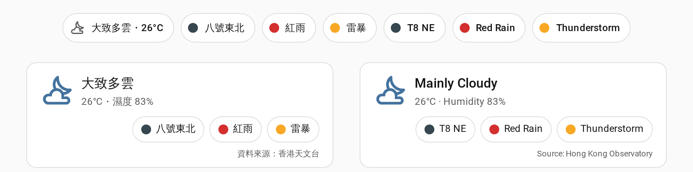

# hkweather

[中文](#中文) | [English](#english)



<sub>截圖為圖示未能載入時的後備樣式；實際使用時，天氣及警告會顯示香港天文台的官方圖示。<br>The screenshot shows the fallback style used when icons cannot load. In normal use, weather and warnings show the Hong Kong Observatory's official icons.</sub>

## 中文

在 Home Assistant dashboard 上顯示香港天文台的**現時天氣圖示**和**生效中的天氣警告**。純前端，不需要改 `configuration.yaml`，也不需要 API key。

- **天氣 badge**（`custom:hkweather-weather-badge`）：天文台現時天氣圖示及說明，可加上溫度和濕度。
- **警告 badge**（`custom:hkweather-warnings-badge`）：只列出生效中的警告，按天文台網站的次序排列；沒有警告時整個隱藏。包括熱帶氣旋信號、預警八號特別報告、暴雨、雷暴、山泥傾瀉、新界北部水浸、強烈季候風、霜凍、火災危險、寒冷、酷熱及海嘯警告。
- **卡片**（`custom:hkweather-card`）：同一張卡顯示天氣和警告，供不用 badge 的版面使用。

數據在瀏覽器內直接向天文台讀取，每 5 分鐘更新一次（可調整）；頁面隱藏時暫停，回到頁面時立即更新。同一頁面上多個 badge 共用同一次請求。更新失敗時會保留上次的資料並變淡顯示，滑鼠移到上面可看到失敗時間。

### 安裝

#### 方法一：HACS（建議）

1. HACS → 右上角選單 → **Custom repositories**，加入 `https://github.com/Huiyuen07/hkweather`，類別選 **Dashboard**。
2. 搜尋「天文台天氣 HKO Weather」並下載。
3. 重新整理瀏覽器。

#### 方法二：手動下載

1. 把 `dist/` 內全部 5 個 `.js` 檔放到 Home Assistant 的 `/config/www/hkweather/`。
2. 設定 → 儀表板 → 右上角選單 → **資源**，新增 `/local/hkweather/hkweather.js`，類型選 **JavaScript 模組**。
3. 以後更新檔案時，在資源網址後加上或更改 `?v=<新版本>`，否則瀏覽器會繼續用舊檔。

### 加入 dashboard

在 sections 版面的 badge 列加入 badge（編輯 dashboard → 新增 badge → 搜尋「天文台」），或直接寫 YAML：

```yaml
badges:
  - type: custom:hkweather-weather-badge
    tap_action:
      action: navigate
      navigation_path: /lovelace/weather
  - type: custom:hkweather-warnings-badge
```

卡片：

```yaml
type: custom:hkweather-card
content: [description, temperature, humidity]
```

### 設定

三個元素共用的欄位：

| 欄位 | 說明 | 預設值 |
|------|------|--------|
| `language` | `auto`（跟隨 Home Assistant）、`tc`（繁體中文）、`sc`（簡體中文）、`en`（English） | `auto` |
| `refresh_minutes` | 更新間隔（分鐘），最少 `1` | `5` |
| `tap_action` | 點擊動作，與 HA 內建 badge 相同（`navigate`、`url`、`perform-action` 等） | `none` |

天氣 badge 和卡片：

| 欄位 | 說明 | 預設值 |
|------|------|--------|
| `content` | 顯示哪些內容：`description`（天氣說明）、`temperature`（溫度）、`humidity`（濕度）。天氣 badge 寫 `[]` 時只顯示圖示 | badge：`[description]`；卡片：`[description, temperature]` |
| `station` | 溫度測站，用天文台的中文站名，例如 `京士柏`、`沙田`。找不到時用 `香港天文台` | `香港天文台` |

警告 badge：

| 欄位 | 說明 | 預設值 |
|------|------|--------|
| `show_empty` | 沒有警告時顯示「現時沒有警告」 | `false`（隱藏） |
| `show_names` | 在圖示旁顯示警告簡稱 | `false` |

卡片：

| 欄位 | 說明 | 預設值 |
|------|------|--------|
| `show_weather` | 顯示現時天氣 | `true` |
| `show_warnings` | 顯示警告 | `true` |
| `show_empty` | 沒有警告時顯示「現時沒有警告」 | `false` |

### 警告次序與圖示

- 次序跟隨天文台網站：熱帶氣旋信號 → 預警八號特別報告 → 暴雨 → 山泥傾瀉 → 雷暴 → 新界北部水浸 → 強烈季候風 → 霜凍 → 火災危險 → 寒冷 → 酷熱 → 海嘯。
- 圖示直接從 `www.hko.gov.hk` 載入，本 repo 不含任何天文台圖示檔。圖示縮放至 70% 放在圓框內，整個圖示保持完整可見。
- 預警八號特別報告沒有官方圖示；任何圖示載入失敗時，會改為顯示色點加警告簡稱。滑鼠移到警告上可看到全名和發出時間。

### 自動化

這些 badge 和卡片在瀏覽器內讀取數據，**不會產生 Home Assistant 實體**，所以不能用來觸發自動化（例如「八號風球時通知」）。需要自動化的話，可另外加一個 REST sensor：

```yaml
# configuration.yaml
rest:
  - resource: https://data.weather.gov.hk/weatherAPI/opendata/weather.php?dataType=warnsum&lang=tc
    scan_interval: 300
    sensor:
      - name: HKO warnings
        unique_id: hko_warnsum
        value_template: "{{ value_json | length }}"
        json_attributes: [WTCSGNL, WRAIN, WTS, WL, WFNTSA, WMSGNL, WFROST, WFIRE, WCOLD, WHOT, WTMW]
```

例如八號或以上信號：

```yaml
triggers:
  - trigger: template
    value_template: >
      
      {{ tc.get('actionCode') != 'CANCEL'
         and tc.get('code') in ['TC8NE', 'TC8SE', 'TC8SW', 'TC8NW', 'TC9', 'TC10'] }}
```

### 資料來源及免責聲明

資料來源：香港天文台、香港特別行政區政府、DATA.GOV.HK。天文台數據及圖示的知識產權屬香港特別行政區政府。本項目與香港天文台沒有任何聯繫。

- 天文台網站資料的使用條件（非商業用途）：https://www.hko.gov.hk/tc/appweb/applink.htm
- 天文台重要告示（含知識產權公告）：https://www.hko.gov.hk/tc/readme/readme.htm
- DATA.GOV.HK 使用條款：https://data.gov.hk/tc/terms-and-conditions

> **免責聲明**
>
> 本網站／刊物／產品／服務載有一些複製或摘錄自香港天文台(下稱「天文台」)網站的資料，有關網站包括 https://www.weather.gov.hk 和 https://www.hko.gov.hk ，以及weather.gov.hk和hko.gov.hk的子域。本網站／刊物／產品／服務所載任何內容提供複製或摘錄自天文台網站所載的資料或連接至天文台網站的連結，並不構成天文台與任何人就本網站／刊物／產品／服務，或所載任何內容有任何形式的合作或聯繫。本網站／刊物／產品／服務並無任何資料構成任何申述、保證或暗示天文台同意、認可、推薦或批准本網站／刊物／產品／服務的任何內容。對於任何因使用、不當使用、依據或不能使用本網站／刊物／產品／服務的任何內容而引致或涉及的任何損失、毀壞或損害(包括但不限於因而造成的損失、毀壞或損害)，天文台概不承擔任何法律責任、義務或責任。

### 授權

本 repo 自寫的程式碼以 [MIT](LICENSE) 授權。天文台的數據、天氣圖示及警告圖示不在 MIT 授權範圍內，使用須遵守上列天文台及 DATA.GOV.HK 的條款，詳見 [NOTICE](NOTICE)。

---

## English

Shows the Hong Kong Observatory's **current weather icon** and **weather warnings in force** on a Home Assistant dashboard. Frontend only: no `configuration.yaml` changes and no API key.

- **Weather badge** (`custom:hkweather-weather-badge`): HKO's current weather icon and caption, optionally with temperature and humidity.
- **Warnings badge** (`custom:hkweather-warnings-badge`): only the warnings in force, in the order the HKO website uses, and hidden entirely when there are none. Covers tropical cyclone signals, the pre-no. 8 special announcement, rainstorm, thunderstorm, landslip, northern New Territories flooding, strong monsoon, frost, fire danger, cold, very hot and tsunami warnings.
- **Card** (`custom:hkweather-card`): weather and warnings in one card, for layouts without badges.

The browser reads the data straight from HKO every 5 minutes (configurable). Polling pauses while the page is hidden and refreshes as soon as it comes back. Several badges on one page share the same requests. If an update fails, the last data stays on screen, dimmed, and the tooltip says when it was last updated.

### Install

#### Option 1: HACS (recommended)

1. HACS → top-right menu → **Custom repositories**, add `https://github.com/Huiyuen07/hkweather` with category **Dashboard**.
2. Search for "天文台天氣 HKO Weather" and download it.
3. Reload the browser.

#### Option 2: Manual download

1. Copy all 5 `.js` files in `dist/` to `/config/www/hkweather/` on Home Assistant.
2. Settings → Dashboards → top-right menu → **Resources**, add `/local/hkweather/hkweather.js` as a **JavaScript module**.
3. After updating the files, add or change `?v=<new version>` on the resource URL, or browsers keep the old files.

### Add to a dashboard

Add the badges to the badge row of a sections view (edit dashboard → add badge → search for "HKO"), or in YAML:

```yaml
badges:
  - type: custom:hkweather-weather-badge
    tap_action:
      action: navigate
      navigation_path: /lovelace/weather
  - type: custom:hkweather-warnings-badge
```

Card:

```yaml
type: custom:hkweather-card
content: [description, temperature, humidity]
```

### Configuration

Fields shared by all three elements:

| Field | Meaning | Default |
|-------|---------|---------|
| `language` | `auto` (follow Home Assistant), `tc` (Traditional Chinese), `sc` (Simplified Chinese) or `en` (English) | `auto` |
| `refresh_minutes` | Refresh interval in minutes, at least `1` | `5` |
| `tap_action` | Tap action, as for HA's built-in badges (`navigate`, `url`, `perform-action` and so on) | `none` |

Weather badge and card:

| Field | Meaning | Default |
|-------|---------|---------|
| `content` | What to show: `description` (weather caption), `temperature`, `humidity`. `[]` on the weather badge shows the icon only | Badge: `[description]`; card: `[description, temperature]` |
| `station` | Temperature station, by HKO's Chinese station name, such as `京士柏` (King's Park) or `沙田` (Sha Tin). Falls back to `香港天文台` (Hong Kong Observatory) if not found | `香港天文台` |

Warnings badge:

| Field | Meaning | Default |
|-------|---------|---------|
| `show_empty` | Show "No warnings in force" when there are none | `false` (hidden) |
| `show_names` | Show each warning's short name next to its icon | `false` |

Card:

| Field | Meaning | Default |
|-------|---------|---------|
| `show_weather` | Show current weather | `true` |
| `show_warnings` | Show warnings | `true` |
| `show_empty` | Show "No warnings in force" when there are none | `false` |

### Warning order and icons

- The order follows the HKO website: tropical cyclone signal → pre-no. 8 special announcement → rainstorm → landslip → thunderstorm → northern New Territories flooding → strong monsoon → frost → fire danger → cold → very hot → tsunami.
- Icons load directly from `www.hko.gov.hk`; this repository contains no HKO icon files. Icons are scaled to 70% inside a round frame, so each whole icon stays visible.
- The pre-no. 8 special announcement has no official icon. If any icon fails to load, a coloured dot and the warning's short name are shown instead. Hover over a warning for its full name and issue time.

### Automations

These badges and the card read data in the browser and **create no Home Assistant entities**, so they cannot trigger automations (such as "notify on signal no. 8"). For automations, add a REST sensor as well:

```yaml
# configuration.yaml
rest:
  - resource: https://data.weather.gov.hk/weatherAPI/opendata/weather.php?dataType=warnsum&lang=tc
    scan_interval: 300
    sensor:
      - name: HKO warnings
        unique_id: hko_warnsum
        value_template: "{{ value_json | length }}"
        json_attributes: [WTCSGNL, WRAIN, WTS, WL, WFNTSA, WMSGNL, WFROST, WFIRE, WCOLD, WHOT, WTMW]
```

For example, signal no. 8 or above:

```yaml
triggers:
  - trigger: template
    value_template: >
      
      {{ tc.get('actionCode') != 'CANCEL'
         and tc.get('code') in ['TC8NE', 'TC8SE', 'TC8SW', 'TC8NW', 'TC9', 'TC10'] }}
```

### Data source and disclaimer

Source: Hong Kong Observatory, Government of the HKSAR, DATA.GOV.HK. Intellectual property rights in HKO data and icons belong to the Government of the Hong Kong Special Administrative Region. This project is not affiliated with the Hong Kong Observatory.

- Conditions for Non-commercial Use of HKO website materials: https://www.hko.gov.hk/en/appweb/applink.htm
- HKO Important Notices (including the Intellectual Property Rights Notice): https://www.hko.gov.hk/en/readme/readme.htm
- DATA.GOV.HK Terms and Conditions: https://data.gov.hk/en/terms-and-conditions

> **Disclaimer**
>
> This website / publication / product / service contains information that is copied or extracted from data made available on the websites of the Hong Kong Observatory (the "Observatory") including https://www.weather.gov.hk , https://www.hko.gov.hk , and the subdomains of "weather.gov.hk" and "hko.gov.hk". The provision of the information copied or extracted from or a link to the Observatory’s websites shall not be constituted as any form of co-operation or affiliation by the Observatory with any person in relation to this website / publication / product / service or any contents herein. Nothing in this website / publication / product / service shall give rise to any representation, warranty or implication that the Observatory agrees with, approves of, recommends or endorses this website / publication / product / service. The Observatory does not have any liability, obligation or responsibility whatsoever for any loss, destruction or damages (including without limitation consequential loss, destruction or damages) howsoever arising from or in respect of your use or misuse of or reliance on or inability to use any contents herein.

### Licence

The code written in this repository is licensed under [MIT](LICENSE). HKO data, weather icons and warning icons are not covered by the MIT licence; their use is subject to the HKO and DATA.GOV.HK terms listed above. See [NOTICE](NOTICE).
